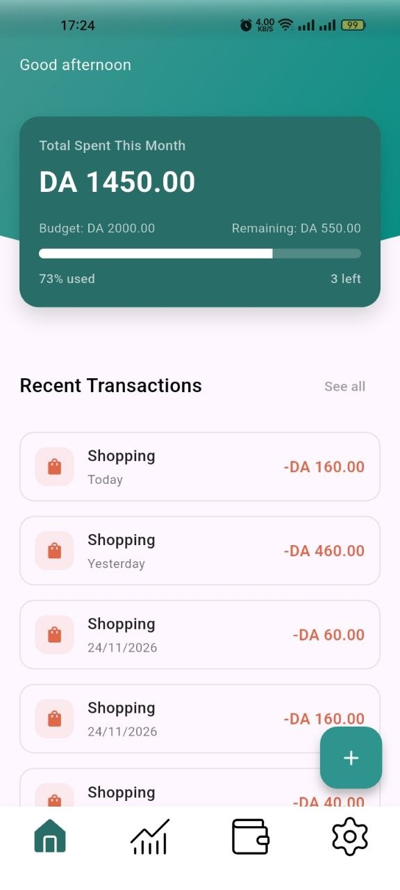
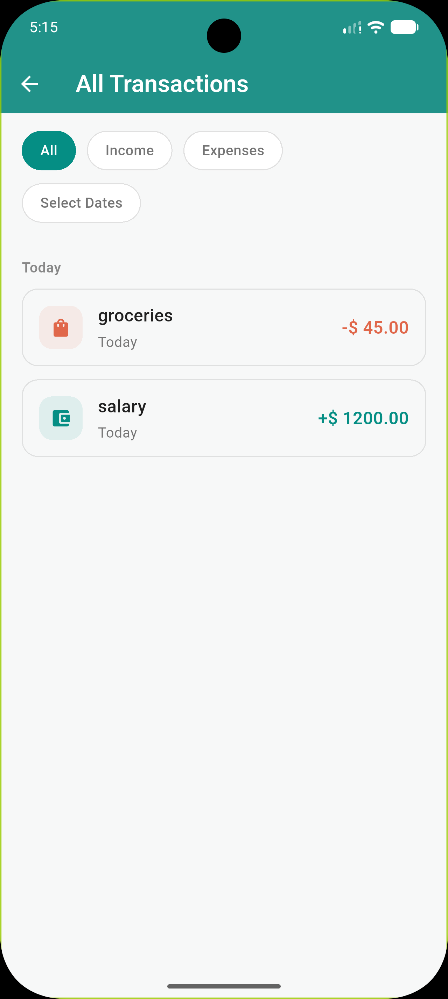
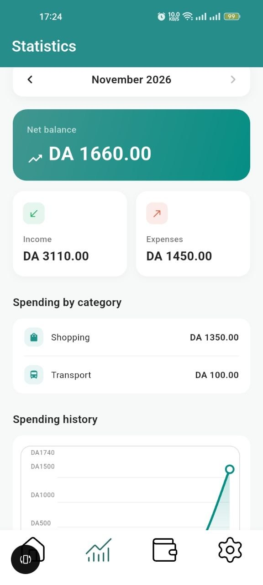
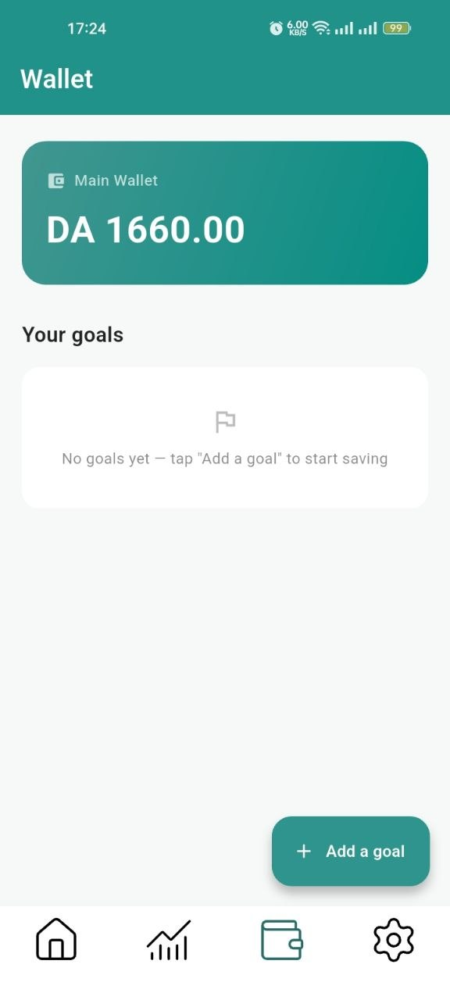
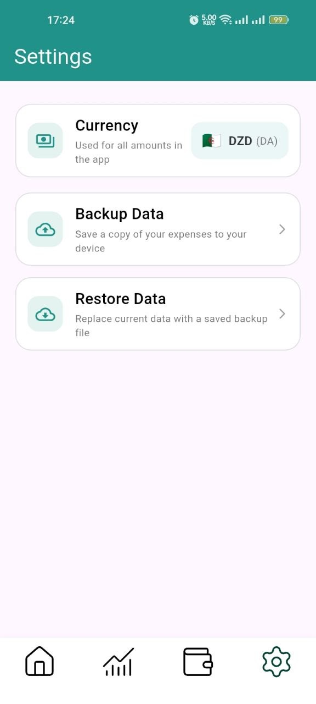

# Maliya

<p align="center">
  
</p>

Maliya is a personal finance management application built with Flutter. It helps users track their income and expenses, manage their monthly budgets, monitor their savings goals, and keep an overview of their financial activity.

## Features

- **Transaction Management:** Create, edit, delete, and browse income and expense transactions, with support for optional notes.
- **Transaction Filtering:** Filter transactions by date range and transaction type (income or expense).
- **Wallet Management:** Automatically update the wallet balance whenever a transaction is added, edited, or deleted.
- **Monthly Budgets:** Set monthly spending limits and track expenses against those limits.
- **Savings Goals:** Create savings goals, track progress, and add or withdraw money.
- **Statistics:** Visualize financial activity through monthly summaries and expense breakdowns.
- **Currency Selection:** Choose a preferred currency for displaying financial amounts.
- **Local Data Storage:** Persist application data locally using SQLite.
- **Data Backup and Restore:** Export application data to JSON backup files and restore it whenever needed.

## Screenshots

<table>
  <tr>
    <th>Home</th>
    <th>All Transactions</th>
  </tr>
  <tr>
    <td align="center"></td>
    <td align="center"></td>
  </tr>
  <tr>
    <th>Statistics</th>
    <th>Wallet and Goals</th>
  </tr>
  <tr>
    <td align="center"></td>
    <td align="center"></td>
  </tr>
  <tr>
    <th colspan="2">Settings</th>
  </tr>
  <tr>
    <td colspan="2" align="center"></td>
  </tr>
</table>

## Built With

- **[Flutter](https://flutter.dev/)** — Cross-platform UI framework.
- **[Dart](https://dart.dev/)** — Programming language.
- **[Drift](https://drift.simonbinder.eu/)** — Type-safe SQLite database library.
- **[SQLite](https://www.sqlite.org/)** — Local relational database.
- **[Provider](https://pub.dev/packages/provider)** — Dependency injection for sharing the database instance across the widget tree.


## Architecture

Maliya follows a layered architecture that separates the user interface, application state management, and database operations.

### Application Structure

- **Presentation Layer:** Flutter screens and widgets responsible for displaying data and handling user interactions.
- **State Management:** `AppData` manages the application's in-memory state and coordinates data operations between the UI and database.
- **Database Layer:** Drift provides a type-safe interface for interacting with the local SQLite database.
- **Data Access Objects (DAOs):** Separate DAOs handle database operations for transactions, wallets, goals, budgets, currencies, and application settings.
- **Backup and Restore:** `DatabaseBackupService` handles JSON backup creation, validation, export, and restoration.

### Data Flow

1. The UI receives application state through `AppData`.
2. User interactions trigger methods in `AppData`.
3. `AppData` communicates with the appropriate DAOs.
4. DAOs perform database operations through Drift.
5. Updated data is reflected in the application state and displayed by the UI.

### Database Management

Maliya uses a single shared `AppDatabase` instance provided through Provider. The database is initialized when the application starts, and `AppData` loads the persisted data into memory.

This approach keeps database access centralized and separates database operations from presentation logic.


## Project Structure

```text
lib/
├── data/
│   └── app_data.dart
├── database/
│   ├── daos/
│   │   ├── app_settings_dao.dart
│   │   ├── category_dao.dart
│   │   ├── currency_dao.dart
│   │   ├── goal_dao.dart
│   │   ├── monthly_budget_dao.dart
│   │   ├── transaction_dao.dart
│   │   ├── transaction_type_dao.dart
│   │   └── wallet_dao.dart
│   ├── tables/
│   │   ├── app_settings.dart
│   │   ├── categories.dart
│   │   ├── currencies.dart
│   │   ├── goals.dart
│   │   ├── monthly_budgets.dart
│   │   ├── transactions.dart
│   │   ├── transaction_types.dart
│   │   └── wallets.dart
│   ├── app_database.dart
│   ├── database_backup.dart
│   ├── database_backup_service.dart
│   └── database_seeder.dart
├── models/
│   ├── goal.dart
│   ├── monthly_budget.dart
│   ├── transaction.dart
│   └── wallet.dart
├── screens/
│   ├── add_goal_sheet.dart
│   ├── add_transaction_sheet.dart
│   ├── all_transactions_page.dart
│   ├── goal_details.dart
│   ├── home_page.dart
│   ├── settings_page.dart
│   ├── stats_page.dart
│   ├── transaction_details.dart
│   └── wallet_page.dart
├── widgets/
│   ├── add_budget_window.dart
│   ├── budget_card.dart
│   ├── currency.dart
│   ├── goal_add_and_remove_money.dart
│   ├── goal_card.dart
│   ├── six_months_chart.dart
│   └── transaction_card.dart
├── buttom_clipper.dart
├── main.dart
└── main_shell.dart
```

### Directory Overview

- **data/** — Application state management and coordination of data operations.
- **database/** — Database configuration, Drift tables, DAOs, data seeding, and backup/restore functionality.
- **models/** — Application data models representing transactions, wallets, goals, and monthly budgets.
- **screens/** — Main application pages and screen-specific interfaces.
- **widgets/** — Reusable UI components shared across different screens.


## Technical Decisions

### Database: Drift and SQLite

Maliya uses Drift as its database layer on top of SQLite.

Drift was chosen over a lower-level SQLite approach because it provides:
- Type-safe database queries and operations.
- Generated code for database access.
- Dedicated Data Access Objects (DAOs) to organize database operations.
- Support for transactions and schema migrations.

### State Management: AppData and Provider

Provider is used to make the shared database instance available across the application.

`AppData` acts as the central coordinator for application data. It initializes and maintains in-memory data, communicates with the database through DAOs, and handles application operations involving multiple data entities.

This separates database access and application logic from the presentation layer.
### Database Migrations

Maliya uses Drift's migration system to manage database schema changes.

The database currently uses schema version 2. The migration from version 1 to version 2 removed the transaction title column while preserving compatible existing transaction data.

### Database Transactions

Drift transactions are used when an operation involves multiple related database changes.

For example, adding an expense updates the transaction record, wallet balance, and monthly budget within a single database transaction. This helps maintain data consistency if an operation fails.

### Data Backup and Restore

Maliya provides JSON-based backup and restore functionality through a dedicated `DatabaseBackupService`.

Backups store user data using stable identifiers such as currency codes and transaction category/type names rather than relying on database-generated IDs. Backup validation is performed before restoring data.


## Installation

1. Go to the [Releases](https://github.com/AissaKifouche/my_expenses_app/releases) page.
2. Download the latest APK.
3. Install the APK on your Android device.

## Database

Maliya uses **SQLite** with **Drift** to store application data locally on the device. Users can export their data as JSON backup files and restore it later.

The database manages:

- Wallet information and balance.
- Income and expense transactions.
- Transaction categories and types.
- Monthly budgets.
- Savings goals.
- Currencies and application settings.

## Project Status

Maliya is an actively developed personal finance application. New features, improvements, and bug fixes may be introduced in future updates.

## License

This project is licensed under the MIT License. See the [LICENSE](LICENSE) file for details.
